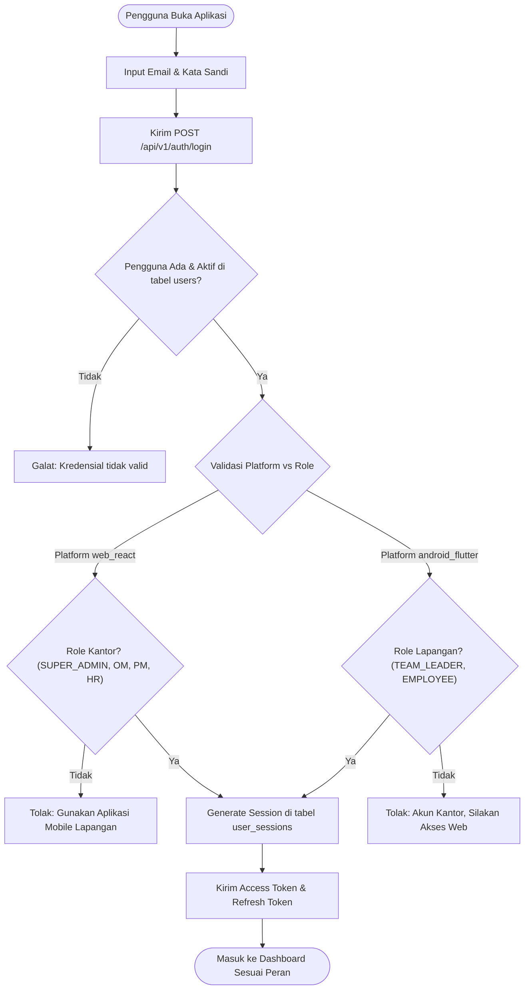
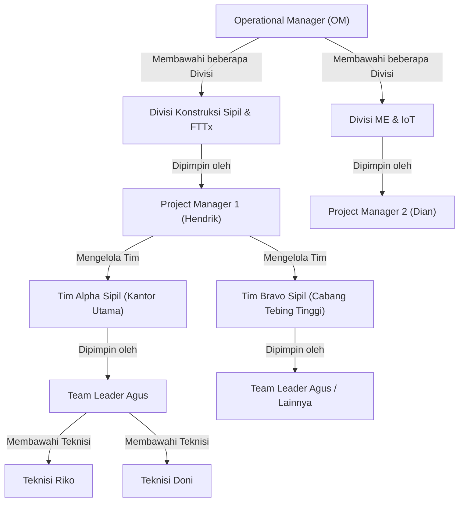
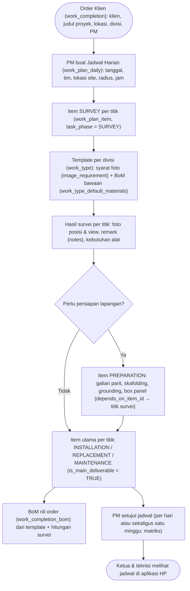
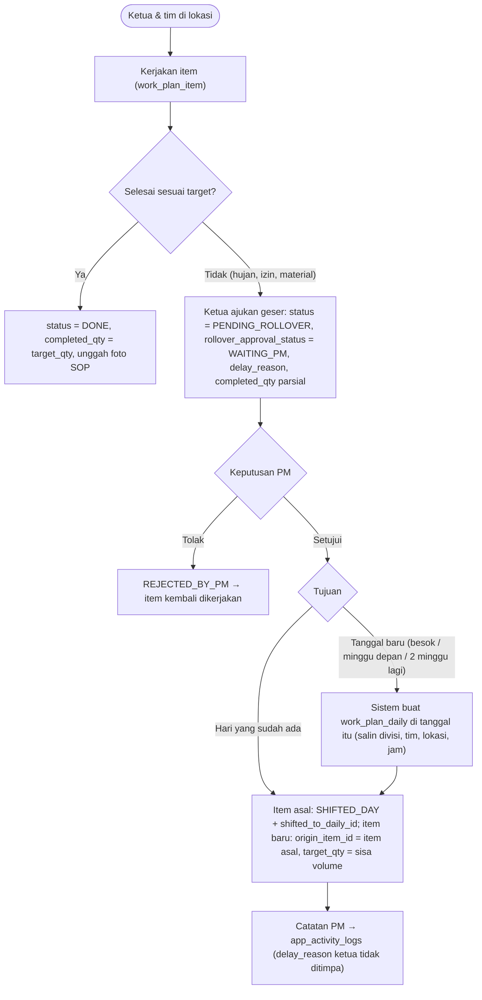
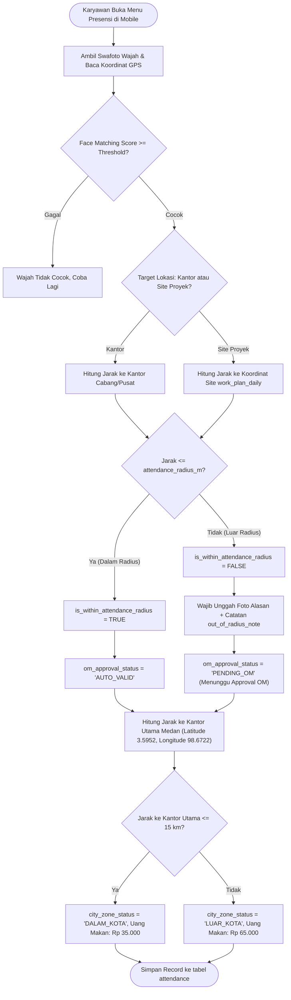
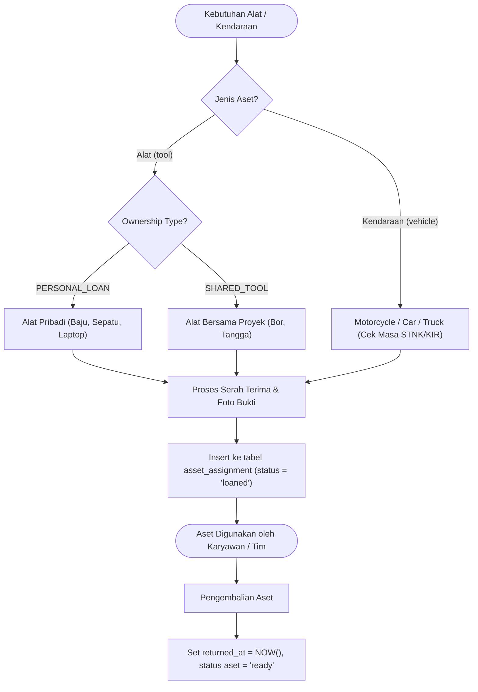
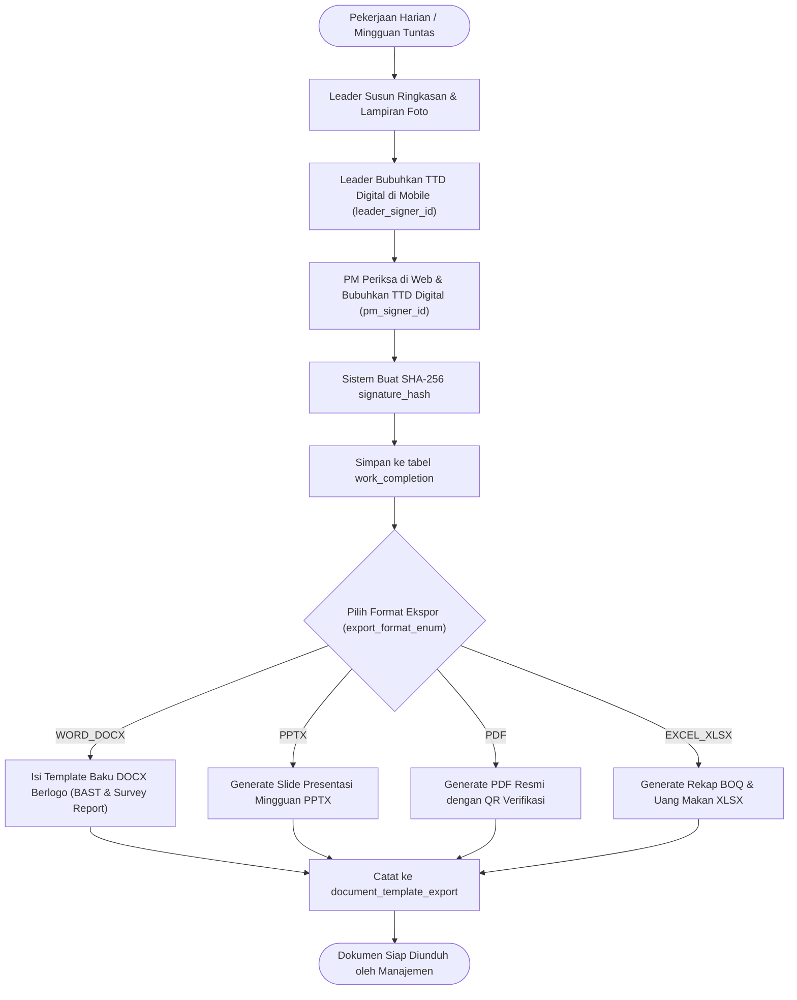

# 35 — Flowchart & Panduan Alur Bisnis VMS V2

Dokumen ini memuat diagram alur operasional menyeluruh berbasis **Master DDL 26 Tabel** untuk PT Visiontech Indograha. Diagram ini menjadi panduan fungsional bagi pengembangan API, Web, dan Mobile.

---

## 1. Alur Autentikasi & Sesi Multi-Platform (Web & Mobile)

---

## 2. Alur Struktur Organisasi (OM $\rightarrow$ PM $\rightarrow$ Leader $\rightarrow$ Teknisi)

---

## 3. Alur Perencanaan Kerja Daily-First (Order Klien → Survei → Persiapan → Instalasi)

> Keputusan pemilik 2026-10-19/20: **tidak ada tabel minggu** (`work_plan_weekly` dihapus, `db/migration_daily_first.sql`).
> Minggu = rentang tanggal `work_date BETWEEN awal AND akhir`. Visiontech adalah subkontraktor: PM menerima order
> dari klien (mis. PT Pertamina Hulu Rokan) lalu menyusun rencana kerja per tahap.

- Template berbeda per divisi: "Survei CCTV" (divisi ME & IoT) ≠ "Survei Wall Display" walau namanya mirip
  (`work_type.division_id`, unik per divisi + nama).
- Satu titik = satu item (`location_name`, `site_lat/lng`) agar proyek multi-minggu terlacak per titik
  (mis. minggu ke-3 titik 1–2, minggu ke-4 titik 8).
- Fase baku `task_phase`: `SURVEY`, `PREPARATION`, `INSTALLATION`, `REPLACEMENT`, `MAINTENANCE`; dipilih per item.
- Siklus jadwal harian (`work_plan_daily.status`, Milestone 5): `DRAFT` → (PM/OM ajukan) `SUBMITTED` → (PM/OM divisi
  setujui; per hari atau sekaligus lewat matriks minggu) `APPROVED` → (ketua mulai pada tanggalnya) `ONGOING` →
  (ketua/PM tutup) `COMPLETED`. Dikembalikan PM: `SUBMITTED/APPROVED` → `DRAFT` + `rejection_reason`. Satu jadwal
  per tim per tanggal; jadwal bisa disalin ke tanggal lain (draf). Tim lapangan hanya melihat jadwal yang sudah
  disetujui; lembur diajukan atas jadwal `ONGOING`.

---

## 4. Alur Rollover: Geser Tugas ke Hari / Minggu Berikutnya

Aturan (keputusan pemilik 2026-10-20):
1. Tanggal tujuan **harus setelah** tanggal asal.
2. Tim & divisi tujuan **sama** dengan hari asal (pindah tim = penugasan ulang, bukan rollover).
3. **Sisa volume terbawa**: item baru `target_qty = target − completed_qty`; item asal tercatat parsial.
4. **Satu rantai aktif**: item yang sudah `SHIFTED_DAY` tidak bisa digeser lagi — yang digeser item lanjutannya.

---

## 5. Alur Presensi Biometrik Wajah, Radius Site, & Uang Makan

---

## 6. Alur Peminjaman Aset (Alat Pribadi vs Umum & Kendaraan)

---

## 7. Alur Penghentian Kerja (Offboarding PKWT) & Clearance Aset

---

## 8. Alur Pelaporan Selesai & Ekspor Dokumen Resmi

**Survey Report (.docx)** — acuan format: laporan "Survey Report New CCTV MGT Minas" (2026-09): kop Visiontech & klien,
tanggal/lokasi/tujuan, tabel jadwal, uraian aktivitas & tim, layout, hitungan instalasi FO per titik, dokumentasi per titik
(foto posisi + view + remark), Bill of Material estimasi, penutup & penanda tangan. Data: order (`work_completion`),
item `SURVEY` per titik (`notes`, `realization_photos_json`), `work_completion_bom`. Dibangun di Milestone 8.
