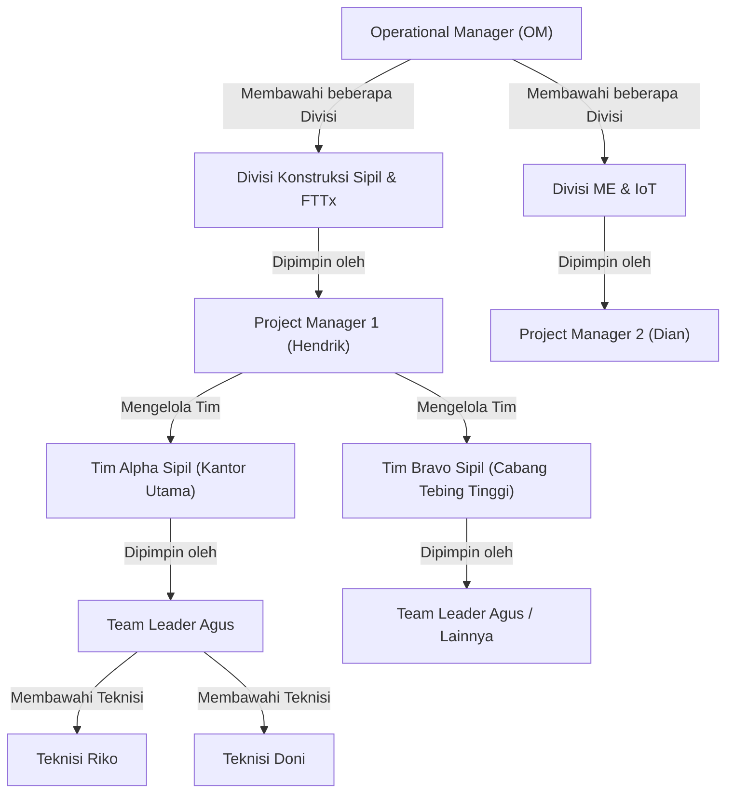
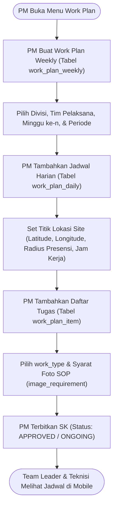
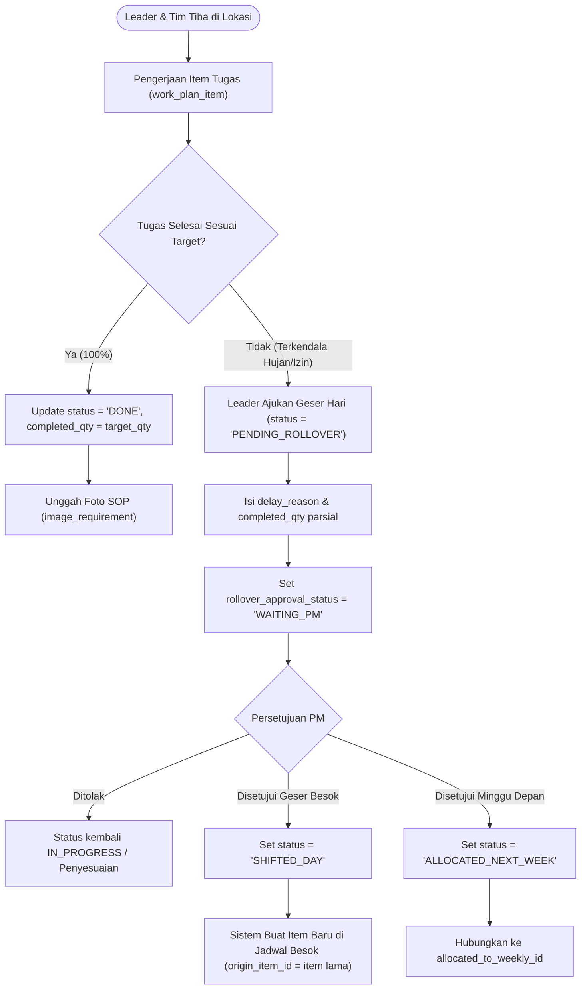
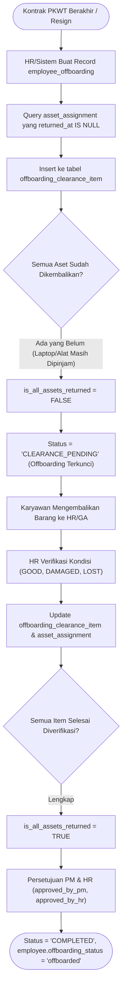
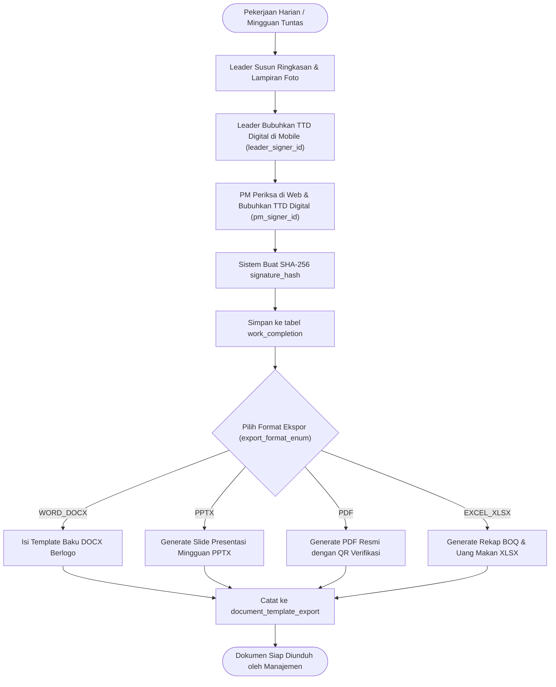

# 35 — Flowchart & Panduan Alur Bisnis VMS V2

Dokumen ini memuat diagram alur operasional menyeluruh berbasis **Master DDL 26 Tabel** untuk PT Visiontech Indograha. Diagram ini menjadi panduan fungsional bagi pengembangan API, Web, dan Mobile.

---

## 1. Alur Autentikasi & Sesi Multi-Platform (Web & Mobile)

---

## 2. Alur Struktur Organisasi (OM $\rightarrow$ PM $\rightarrow$ Leader $\rightarrow$ Teknisi)

---

## 3. Alur Perencanaan Kerja Mingguan & Harian (Work Plan)

---

## 4. Alur Engine Rollover & Geser Hari Tugas Lapangan

---

## 5. Alur Presensi Biometrik Wajah, Radius Site, & Uang Makan

---

## 6. Alur Peminjaman Aset (Alat Pribadi vs Umum & Kendaraan)

---

## 7. Alur Penghentian Kerja (Offboarding PKWT) & Clearance Aset

---

## 8. Alur Pelaporan Selesai & Ekspor Dokumen Resmi

