# 01. Flowchart end-to-end

Dibuat dari kode per 2026-10-29. Setiap node mencantumkan peran pelaku, layar (route web atau layar mobile), dan endpoint utama.
Legenda layar:

- **Web**: route dari `web/src/app/routes.tsx` dan `web/src/app/navigation.ts`, misalnya `/work-plans`, `/surveys/:id`.
- **HP**: layar Flutter dari `mobile/lib/shared/router.dart`, misalnya `AttendanceScreen` (tab `/`), `DailyPlansScreen` (tab `/plans`).

Simbol: `[...]` langkah, `{...}` keputusan.

```mermaid
flowchart TD
    subgraph MASTER["A. Master data (web kantor)"]
        A1["Klien<br/>Peran: PM, OM, OPS, SUPER_ADMIN<br/>Web: /clients"]
        A2["Proyek<br/>Peran: PM, OM, OPS, SUPER_ADMIN<br/>Web: /projects<br/>Status ONGOING wajib untuk jadwal dan order"]
        A3["Jenis pekerjaan dengan template foto dan material<br/>Peran: PM divisinya, OM, SUPER_ADMIN<br/>Web: /work-types"]
        A4["Tim lapangan dan lokasi kerja<br/>Peran: PM (tim), OM (lokasi, divisi)<br/>Web: /teams, /sites"]
    end

    subgraph ORDER["B. Order klien"]
        B1["Order klien dibuat<br/>Peran: SUPER_ADMIN, OM, PM (atas nama diri sendiri)<br/>Web: /work-completions<br/>acc_status awal MENUNGGU_ACC"]
    end

    subgraph SURVEI["C. Survei (ACS atau CCTV)"]
        C1{"Order butuh survei?"}
        C2["PM buat item fase SURVEY di jadwal<br/>Peran: PM, OM<br/>Web: /work-plans"]
        C3["Ketua isi titik, material, laporan, foto<br/>Peran: ketua tim jadwal<br/>HP: SurveyScreen dari DailyPlanScreen"]
        C4["Ketua kirim survei (submit)<br/>POST /work-plans/surveys/:id/submit<br/>Syarat: minimal 1 titik, foto slot lengkap"]
        C5{"PM tinjau survei<br/>Web: /surveys/:id"}
        C6["Rencana dari survei: buat jadwal lanjutan<br/>Peran: PM, OM<br/>POST /work-plans/surveys/:id/plan"]
    end

    subgraph JADWAL["D. Jadwal harian (web)"]
        D1["Buat jadwal harian DRAFT per tim per tanggal<br/>Peran: PM, OM divisinya, SUPER_ADMIN<br/>Web: /work-plans, POST /work-plans/daily<br/>Salin ke tanggal lain: POST /work-plans/daily/:id/copy (item ikut disalin)"]
        D2["Tambah item pekerjaan per titik<br/>Jenis pekerjaan, order, tim, lokasi<br/>POST /work-plans/daily/:id/items"]
        D3["Submit: DRAFT ke SUBMITTED<br/>Peran: PM, OM divisinya<br/>Syarat: minimal 1 item (422 PLAN_EMPTY)"]
        D4{"Setujui atau tolak"}
        D5["Jadwal APPROVED, dirilis ke tim<br/>Syarat: minimal 1 item (422 PLAN_EMPTY)<br/>Notifikasi ke tim"]
    end

    subgraph LAPANGAN["E. Lapangan (HP)"]
        E1["Absen masuk: swafoto wajah dan GPS<br/>Peran: ketua, anggota (kanal MOBILE)<br/>HP: AttendanceScreen, tab /<br/>POST /attendance/check-in"]
        E2{"Absen lolos validasi?"}
        E3["Ketua mulai hari kerja: ONGOING<br/>Peran: ketua jadwal<br/>HP: DailyPlanScreen, tab /plans<br/>POST /work-plans/daily/:id/start<br/>Syarat: absen masuk ketua hari ini (409 CHECKIN_REQUIRED)"]
        E4["Kerjakan item: isi progres dan foto wajib<br/>Peran: ketua, anggota tim<br/>HP: ItemProgressScreen<br/>PATCH /work-plans/items/:id/progress"]
        E5{"Item selesai (qty tercapai)?"}
        E6["Ajukan pindah hari dengan alasan<br/>Peran: ketua<br/>POST /work-plans/items/:id/request-rollover"]
        E7{"Keputusan PM<br/>Web: panel item di /work-plans<br/>POST /work-plans/items/:id/rollover-decision"}
        E8["Item lama SHIFTED_DAY, item baru di tanggal tujuan"]
        E9["Ajukan lembur (opsional)<br/>Peran: ketua, anggota saat ONGOING<br/>HP: DailyPlanScreen<br/>POST /overtime, diputus PM atau OM"]
        E11["Isi laporan harian<br/>Peran: ketua atau PM, OM<br/>POST /work-plans/daily/:id/report"]
        E12["Absen pulang<br/>Peran: ketua, anggota<br/>POST /attendance/check-out"]
        E13["Selesaikan hari kerja: COMPLETED<br/>Peran: ketua atau PM, OM<br/>POST /work-plans/daily/:id/complete<br/>Syarat: laporan harian ada (422 REPORT_REQUIRED), tanpa koreksi terbuka (409 CORRECTION_OPEN) dan tanpa pindah hari menunggu (409 ROLLOVER_PENDING)"]
    end

    subgraph ABSENREVIEW["F. Tinjau absensi"]
        F1{"Absen NEEDS_REVIEW<br/>(luar radius, offline, wajah layanan mati)"}
        F2["Peninjau: OM, PM (SQL can_review)<br/>Web: /attendance<br/>POST /attendance/:id/review, catatan wajib"]
    end

    subgraph KOREKSI["G. Koreksi laporan"]
        G0{"Ada koreksi laporan?"}
        G1["Ketua minta koreksi (jadwal COMPLETED)<br/>HP: DailyPlanScreen<br/>POST /work-plans/daily/:id/corrections"]
        G2{"PM putuskan<br/>Web: CorrectionsPanel<br/>POST /work-plans/corrections/:id/decision"}
        G3["Ketua revisi, jadwal kembali ONGOING<br/>Ketua kirim revisi: POST /work-plans/corrections/:id/submit"]
        G4{"PM terima atau kembalikan"}
    end

    subgraph ORDERTUTUP["H. Penutupan order dan BAST"]
        H1{"ACC klien<br/>Web: /work-completions<br/>POST /work-completions/:id/acc-decision"}
        H2["DITOLAK_REWORK: item utama dibuka ulang TODO<br/>Kembali ke jadwal harian"]
        H3["DITERIMA: lanjut ke BAST"]
        H4["BAST: tanda tangan ketua tim<br/>Peran: TEAM_LEADER yang mengerjakan order<br/>HP: BastSignScreen<br/>POST /work-completions/:id/sign"]
        H5["BAST: tanda tangan PM atau OM, mengunci order<br/>Web: /work-completions<br/>POST /work-completions/:id/sign<br/>Simpan signature_hash SHA-256"]
    end

    subgraph EKSPOR["I. Ekspor dan verifikasi"]
        I1["Ekspor dokumen order<br/>POST /exports/work-completions/:id<br/>BAST docx (dengan ringkasan harian dan halaman peta), survei docx, BAST PDF ber-QR, BoQ xlsx, slide pptx, surat tugas order (ORDER_SHEET, docx)"]
        I2{"Template BAST_PDF?"}
        I3["Ditolak 409 NOT_SIGNED<br/>sebelum PM tanda tangan"]
        I4["Berkas tersimpan di MinIO<br/>Unduh: GET /exports/:id/file"]
        I5["Verifikasi publik lewat QR, tanpa login<br/>Web: /verify/work-completion/:id?h=sha256<br/>GET /verify/work-completions/:id"]
        I6["Rekap periodik xlsx atau pptx<br/>Peran: PM, OM, OPS, SUPER_ADMIN<br/>POST /exports/periodic"]
        I7["Laporan harian satu jadwal (docx)<br/>Peran: ketua atau anggota tim, PM atau OM divisi (jadwal dirilis)<br/>POST /exports/daily-report"]
        I8["Laporan mingguan tim (pptx) dari web<br/>Peran: ketua atau anggota tim, PM atau OM divisi<br/>POST /exports/team-week"]
    end

    A1 --> B1
    A2 --> B1
    A3 --> C2
    B1 --> C1
    C1 -->|"ya"| C2
    C1 -->|"tidak"| D1
    C2 --> C3
    C3 --> C4
    C4 --> C5
    C5 -->|"setujui"| C6
    C5 -->|"kembalikan"| C3
    C6 --> D1
    A4 --> D1
    D1 --> D2
    D2 --> D3
    D3 --> D4
    D4 -->|"tolak dengan alasan"| D1
    D4 -->|"setujui"| D5
    D5 --> E1
    E1 --> E2
    E2 -->|"tidak"| E1
    E2 -->|"ya, jadwal hari ini"| E3
    E2 -->|"ya, tapi NEEDS_REVIEW"| F1
    F1 --> F2
    E3 --> E4
    E4 --> E5
    E5 -->|"belum, tidak selesai hari ini"| E6
    E6 --> E7
    E7 -->|"setujui"| E8
    E7 -->|"tolak"| E4
    E5 -->|"ya"| E9
    E9 --> E11
    E11 --> E12
    E12 --> E13
    E13 --> G0
    G0 -->|"ya"| G1
    G0 -->|"tidak"| H1
    G1 --> G2
    G2 -->|"setujui"| G3
    G2 -->|"tolak"| H1
    G3 --> G4
    G4 -->|"kembalikan"| G3
    G4 -->|"terima"| H1
    E8 --> E4
    H1
    H1 -->|"DITOLAK_REWORK"| H2
    H2 --> D1
    H1 -->|"DITERIMA"| H3
    H3 --> H4
    H4 --> H5
    H5 --> I1
    I1 --> I2
    I2 -->|"ya, belum ditandatangani PM"| I3
    I2 -->|"ya, sudah"| I4
    I1 --> I4
    I4 --> I5
    I1 --> I6
```

## Catatan membaca diagram

- Alur ACC ke BAST di atas adalah alur yang dimaksudkan. Kode `sign_order` tidak memeriksa `acc_status` (`api/app/modules/work_completion/services/work_completion_service.py:274-330`). Artinya BAST bisa ditandatangani sebelum ACC DITERIMA. Lihat T10 di `README.md`. [VERIFIKASI]
- Jadwal lanjutan dari survei (C6) memakai alur tim dan jadwal yang sama dengan D1. Jadwal tujuan harus berstatus DRAFT atau SUBMITTED, bukan sudah APPROVED (`api/app/modules/work_plans/services/survey_service.py:354-356`).
- Koreksi laporan (G) hanya bisa dimulai saat jadwal COMPLETED (`api/app/modules/work_plans/services/daily_correction_service.py:38-39`).
- Item yang sudah dipindah (E8) menjadi item baru di jadwal tujuan dengan status TODO dan volume sisa (`api/app/modules/work_plans/repositories/plan_item_repository.py:252-268`).
- Absen yang lolos di luar radius hanya diterima bila disertai penjelasan (`api/app/modules/attendance/services/attendance_session_service.py:387-393`). Jika tanpa penjelasan, absen ditolak 422 `EXPLANATION_REQUIRED`.
