# 02. State machine

Dibuat dari kode per 2026-10-29. Setiap transisi mencantumkan endpoint, peran yang boleh (sesuai `00-peran-dan-izin.md`), prasyarat validasi, dan efek samping. Bukti berupa berkas:baris.

Catatan: label transisi memakai nama endpoint dan peran. Kode galat 409 untuk status tidak sesuai, 422 untuk validasi, 403 untuk izin atau relasi.

## 2.1 DailyStatus (`work_plan_daily.status`)

Status: DRAFT, SUBMITTED, APPROVED, ONGOING, COMPLETED (`api/app/modules/work_plans/schemas/daily_plan_schema.py:16`).

| Transisi | Endpoint | Siapa | Prasyarat | Efek samping | Bukti |
|---|---|---|---|---|---|
| (awal) to DRAFT | POST /work-plans/daily/:id/copy | PM, OM divisi, SUPER_ADMIN (MANAGE jadwal sumber) | Tanggal tujuan tidak lampau; cek tim, proyek. Lokasi, jam, tim, dan item disalin; progres item direset; item survei dan item yang bergantung prasyarat tidak disalin | Satu baris DRAFT per tanggal (`copy_items`) | `daily_plan_service.py` (`copy`); `daily_plan_route.py` (`/copy`) |
| (awal) to DRAFT | POST /work-plans/daily | PM, OM divisi, SUPER_ADMIN | Divisi aktif; tim milik divisi; tanggal tidak lampau, kecuali PM/OM dengan `backdate_reason` untuk tanggal <= 7 hari lalu (F10, tercatat `BACKDATE_CREATED` di audit; tanpa alasan 422); tim belum punya jadwal di tanggal itu (409 TEAM_DAY_TAKEN); proyek ONGOING bila dipakai | Baris dibuat dengan created_by | `daily_plan_service.py:140-150`, `:113-119`, `:121-138`; `access_service.py:94-100` |
| DRAFT to SUBMITTED | POST /work-plans/daily/:id/submit | MANAGE (PM, OM divisi, SUPER_ADMIN) | Status DRAFT (409); minimal 1 item (422 `PLAN_EMPTY`) | Notifikasi `daily_submitted` | `daily_plan_service.py:215-220`; `daily_plan_route.py:131` |
| DRAFT or SUBMITTED to APPROVED | POST /work-plans/daily/:id/approve, atau POST /work-plans/daily/approve (matriks) | MANAGE | Status DRAFT atau SUBMITTED (409); tanggal tidak lebih dari 7 hari lalu (422; persetujuan tanggal lampau tercatat `BACKDATE_APPROVED`); minimal 1 item (422 `PLAN_EMPTY`). Matriks melewati item yang gagal dan mengembalikan daftar `skipped`. | `approved_by` diisi, notifikasi `daily_approved` | `daily_plan_service.py:222-240`; `daily_plan_route.py:89,138` |
| SUBMITTED or APPROVED to DRAFT | POST /work-plans/daily/:id/reject | MANAGE | Status SUBMITTED atau APPROVED (409); alasan wajib | `rejection_reason` disimpan, notifikasi `daily_rejected` | `daily_plan_service.py:242-247`; `daily_plan_route.py:145` |
| APPROVED to ONGOING | POST /work-plans/daily/:id/start | Ketua jadwal saja (relasi LEADER). SUPER_ADMIN tidak lolos kecuali juga ketua. | Status APPROVED (409); `work_date` tidak lebih dari hari ini (422); ketua sudah absen masuk pada tanggal jadwal ATAU pada hari ini WIB (409 `CHECKIN_REQUIRED`; F11, jadwal lampau yang belum dimulai bisa dimulai bila ketua absen hari ini) | Tim mulai mengerjakan item | `daily_plan_service.py:249-255`; `access_service.py:87` |
| ONGOING to COMPLETED | POST /work-plans/daily/:id/complete | Ketua jadwal atau MANAGE | Status ONGOING (409); tanpa koreksi terbuka (409 `CORRECTION_OPEN`); tanpa pindah hari menunggu keputusan (409 `ROLLOVER_PENDING`); laporan harian sudah ada, bila tidak 422 REPORT_REQUIRED | Hasil dikunci. Perubahan berikutnya lewat koreksi. | `daily_plan_service.py:257-269`; `daily_plan_route.py:159` |
| COMPLETED to ONGOING | (efek POST /work-plans/corrections/:id/decision APPROVE) | PM, OM divisi | Koreksi berstatus REQUESTED | `set_plan_status(ONGOING)` | `daily_correction_service.py:75-77` |
| DRAFT, SUBMITTED, or APPROVED (belum ONGOING) to (arsip) | DELETE /work-plans/daily/:id | MANAGE | Status DRAFT, SUBMITTED, atau APPROVED (F10, hapus lunak dengan konfirmasi di UI); belum ada absensi atau peminjaman aset (409 DAILY_PLAN_IN_USE) | Baris diarsipkan (`archive`) | `daily_plan_service.py:200-205` |

Catatan: ubah jadwal (PUT) hanya saat DRAFT atau SUBMITTED (`daily_plan_service.py:152-154`, `EDITABLE` pada `:39`).

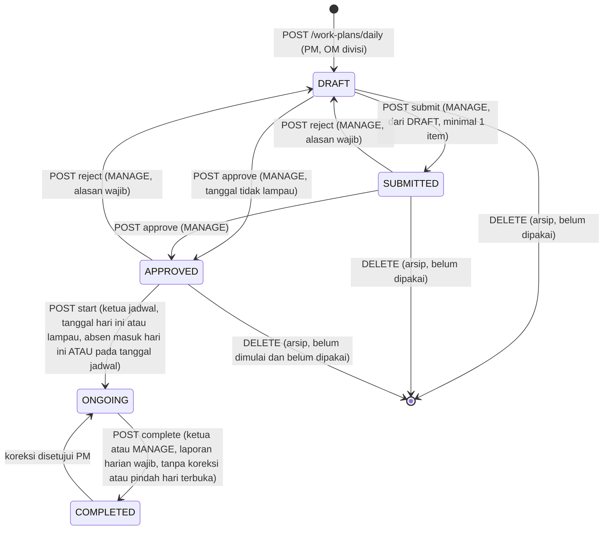

## 2.1a Kind jadwal: SIAGA ke WORK (`work_plan_daily.kind`)

Kind: WORK (jadwal kerja) atau STANDBY (SIAGA: tim menunggu perintah PM, tanpa item wajib) (`api/app/modules/work_plans/schemas/daily_plan_schema.py:DailyKind`). Kind tidak berubah lewat PUT. Satu-satunya jalan dari STANDBY ke WORK adalah aktivasi.

| Transisi | Endpoint | Siapa | Prasyarat | Efek samping | Bukti |
|---|---|---|---|---|---|
| (awal) to STANDBY | POST /work-plans/daily/bulk-standby, atau POST /work-plans/daily/bulk dengan kind STANDBY | PM, OM divisi | Tim dan tanggal; sel yang sudah berisi dilewati (TEAM_DAY_TAKEN) | Baris kind STANDBY; target APPROVED boleh (tanpa item) | `daily_plan_service.py` (`bulk_create`); `daily_plan_schema.py` (`DailyBulkIn`) |
| STANDBY to WORK | POST /work-plans/daily/:id/activate | PM, OM divisi (MANAGE) | Kind STANDBY (409 BUKAN_SIAGA); status DRAFT, SUBMITTED, atau APPROVED (409); minimal satu item (422) | Item ditambahkan, kind = WORK, notifikasi DAILY_ACTIVATED ke ketua dan anggota | `daily_plan_service.py:396-413`; `daily_plan_route.py` (`/activate`) |

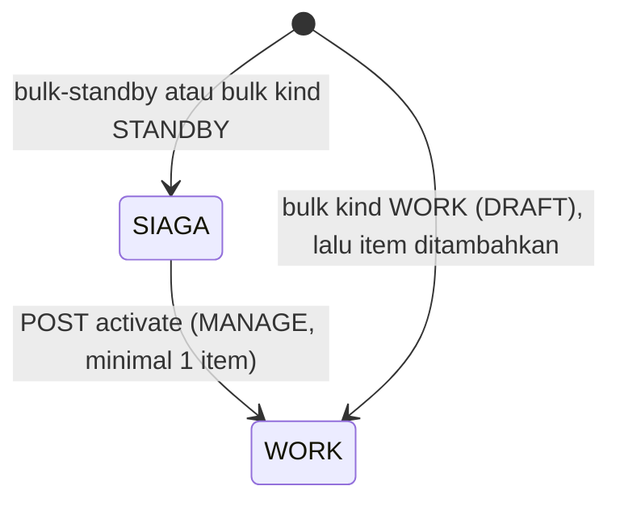

## 2.2 ItemStatus (`work_plan_item.status`) dan RolloverStatus

ItemStatus: TODO, IN_PROGRESS, DONE, PENDING_ROLLOVER, SHIFTED_DAY, CANCELLED (`api/app/modules/work_plans/schemas/plan_item_schema.py:18`). RolloverStatus: NONE, WAITING_PM, APPROVED_BY_PM, REJECTED_BY_PM (`:19`).

| Transisi | Endpoint | Siapa | Prasyarat | Efek samping | Bukti |
|---|---|---|---|---|---|
| (awal) to TODO | POST /work-plans/daily/:id/items | MANAGE | Jadwal DRAFT atau SUBMITTED (409) | Item dibuat | `plan_item_service.py:115-117` |
| TODO or IN_PROGRESS to IN_PROGRESS | PATCH /work-plans/items/:id/progress | Ketua atau anggota tim (TEAM); jadwal ONGOING | completed_qty dalam target (422); prasyarat item belum selesai (409 PREREQUISITE_NOT_DONE); foto ada di berkas (422) | Status dihitung ulang di SQL | `plan_item_service.py:164-192`; `plan_item_repository.py:197-213` |
| TODO or IN_PROGRESS to DONE | PATCH /work-plans/items/:id/progress | Ketua atau anggota tim; ONGOING | completed_qty >= target. Semua foto syarat wajib harus ada (422 PHOTOS_REQUIRED). | `progress_percent` 100 | `plan_item_service.py:186-190`; `plan_item_repository.py:205` |
| DONE to IN_PROGRESS | PATCH /work-plans/items/:id/progress | Ketua atau anggota tim | Tidak ada guard status DONE (lihat T6) [VERIFIKASI] | Status diturunkan ulang sesuai qty | `plan_item_repository.py:205` |
| TODO or IN_PROGRESS to PENDING_ROLLOVER | POST /work-plans/items/:id/request-rollover | Ketua (LEADER) | Jadwal APPROVED atau ONGOING (409); item belum DONE, SHIFTED_DAY, atau PENDING (409); completed_qty kurang dari target (422) | `rollover_approval_status = WAITING_PM`, alasan disimpan | `plan_item_service.py:194-202`; `plan_item_repository.py:233-242` |
| PENDING_ROLLOVER to IN_PROGRESS atau TODO | POST /work-plans/items/:id/rollover-decision (approve false) | PM, OM divisi (MANAGE) | rollover_approval_status WAITING_PM (409) | `REJECTED_BY_PM`; status IN_PROGRESS bila completed > 0, selain itu TODO; log keputusan | `plan_item_service.py:204-226`; `plan_item_repository.py:244-250` |
| PENDING_ROLLOVER or TODO or IN_PROGRESS to SHIFTED_DAY | POST /work-plans/items/:id/rollover-decision (approve true) | MANAGE | Item tidak DONE atau SHIFTED_DAY (409). Tim tujuan sama dengan tim asal (422). Jadwal tujuan satu divisi (422), tidak COMPLETED (409), tanggal setelah asal (422), tidak lampau (422). Bisa proaktif (tanpa request). | Item asal SHIFTED_DAY dan APPROVED_BY_PM. Item baru TODO di jadwal tujuan dengan sisa volume, `origin_item_id` menunjuk asal. Dependen direlink. Jadwal tujuan dibuat bila belum ada (`clone_day`). | `plan_item_service.py:228-275`; `plan_item_repository.py:252-268` |
| SHIFTED_DAY | (akhir, tidak bisa diubah) | | Progress menolak status ini (409) | | `plan_item_service.py:167-168` |
| (tidak ada penulis) CANCELLED | | | Nilai hanya ada di skema, tidak ada penulis (T5) [VERIFIKASI] | | `plan_item_schema.py:18` |

Keputusan pindah hari bisa dilakukan tanpa request (proaktif, `plan_item_service.py:256-258`, nilai `proactive`). Item DONE atau SHIFTED_DAY tidak bisa diputuskan (409).

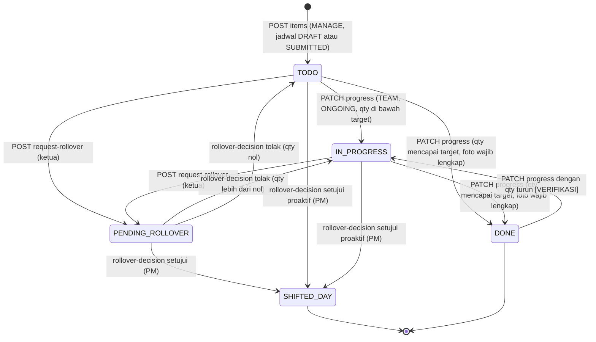

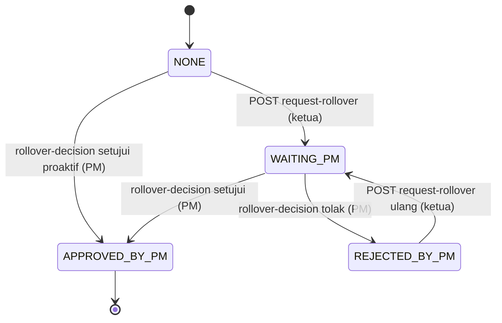

## 2.3 SurveyState (turunan dari status tugas survei)

Survei adalah item `task_phase = SURVEY`. Status diturunkan (`api/app/modules/work_plans/services/survey_service.py:46-49`):

- APPROVED bila `approved_by_pm_id` terisi.
- SUBMITTED bila status item DONE.
- DRAFT lainnya.

Pengubah status: `set_task_state` di `api/app/modules/work_plans/repositories/survey_repository.py:250-262`.

| Transisi | Endpoint | Siapa | Prasyarat | Efek samping | Bukti |
|---|---|---|---|---|---|
| (awal) to DRAFT | (dari item fase SURVEY) | PM, OM membuat item | Item survei terkait ke order, bukan revisi tanpa order (409 atau 422) | Tugas survei tersedia untuk ketua | `survey_service.py:67-72` |
| DRAFT, isi titik dan material | POST /work-plans/surveys/:id/points, PUT .../lines, POST .../catalog, PUT .../report | Ketua (LEADER) | Jadwal APPROVED atau ONGOING (409); survei belum dikirim (409) | Titik, BoM, dan laporan tersimpan | `survey_service.py:76-83`, `:85-99` |
| DRAFT to SUBMITTED | POST /work-plans/surveys/:id/submit | Ketua (LEADER) | Minimal 1 titik (422); foto slot lengkap per titik (422 PHOTOS_REQUIRED) | Status item DONE; log SURVEY_SUBMITTED | `survey_service.py:251-270`; `survey_repository.py:250-262` |
| SUBMITTED to APPROVED | POST /work-plans/surveys/:id/review (APPROVE) | PM, OM divisi (MANAGE) | Status SUBMITTED (409) | `approved_by_pm_id` terisi; dependen SURVEY ikut DONE | `survey_service.py:325-333`; `survey_repository.py:250-262` |
| SUBMITTED to DRAFT | POST /work-plans/surveys/:id/review (RETURN) | MANAGE | Status SUBMITTED (409) | Status IN_PROGRESS; `approved_by_pm_id` kosong; survei bisa diisi ulang | `survey_service.py:325-333` |
| APPROVED to (rencana) | POST /work-plans/surveys/:id/plan | MANAGE, CREATE_PLAN | Survei APPROVED (409). Jadwal tujuan DRAFT atau SUBMITTED (409), satu divisi (422), tanggal tidak sebelum survei (422). Minimal 1 titik (422). | Item pemasangan dibuat di jadwal tujuan | `survey_service.py:335-404` |

Titik ukur: pratinjau dan ekspor laporan survei hanya saat sudah dikirim. Draf menghasilkan 409 `SURVEY_NOT_SUBMITTED` (`api/app/modules/exports/services/export_service.py:118-121`).

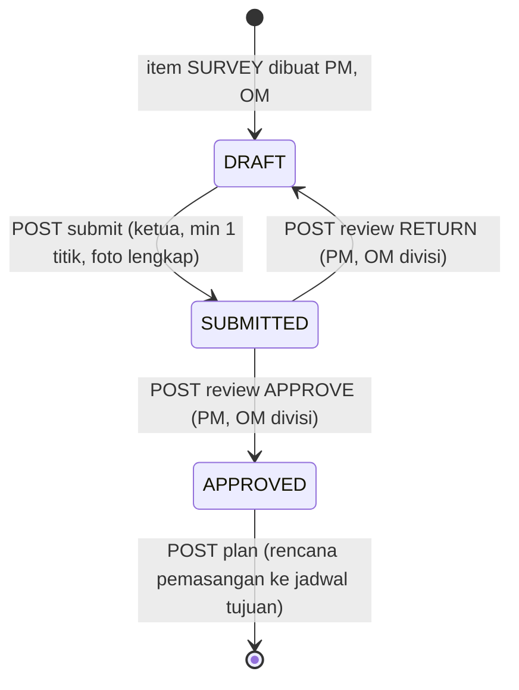

## 2.4 CorrectionStatus (`daily_correction`)

Status: REQUESTED, REVISING, IN_REVIEW, ACCEPTED, REJECTED (`api/app/modules/work_plans/schemas/daily_correction_schema.py:13`). Status terbuka: REQUESTED, REVISING, IN_REVIEW (`daily_correction_service.py:27`).

| Transisi | Endpoint | Siapa | Prasyarat | Efek samping | Bukti |
|---|---|---|---|---|---|
| (awal) to REQUESTED | POST /work-plans/daily/:id/corrections | Ketua (LEADER) | Jadwal COMPLETED (409); tidak ada koreksi terbuka (409 CORRECTION_OPEN); akun tertaut karyawan | Notifikasi ke PM divisi | `daily_correction_service.py:37-51` |
| REQUESTED to REVISING | POST /work-plans/corrections/:id/decision (APPROVE) | MANAGE | Status REQUESTED (409) | Jadwal ONGOING; ketua boleh mengubah progres dan laporan | `daily_correction_service.py:67-77` |
| REQUESTED to REJECTED | POST /work-plans/corrections/:id/decision (REJECT) | MANAGE | Status REQUESTED (409) | Jadwal tetap COMPLETED | `daily_correction_service.py:78-79` |
| REVISING to IN_REVIEW | POST /work-plans/corrections/:id/submit | Ketua (LEADER) | Status REVISING (409); laporan harian ada (422 REPORT_REQUIRED) | `bump_revision`, jumlah revisi naik | `daily_correction_service.py:101-113` |
| IN_REVIEW to ACCEPTED | POST /work-plans/corrections/:id/decision (ACCEPT) | MANAGE | Status IN_REVIEW (409) | Jadwal COMPLETED | `daily_correction_service.py:81-85` |
| IN_REVIEW to REVISING | POST /work-plans/corrections/:id/decision (RETURN) | MANAGE | Status IN_REVIEW (409) | Ketua revisi lagi | `daily_correction_service.py:86-87` |

Catatan: saat REVISING atau IN_REVIEW, jadwal berstatus ONGOING. Kode `complete` tidak memeriksa koreksi terbuka (`daily_plan_service.py:257-269`). Ketua bisa menutup jadwal lagi di tengah koreksi. Lihat T7.

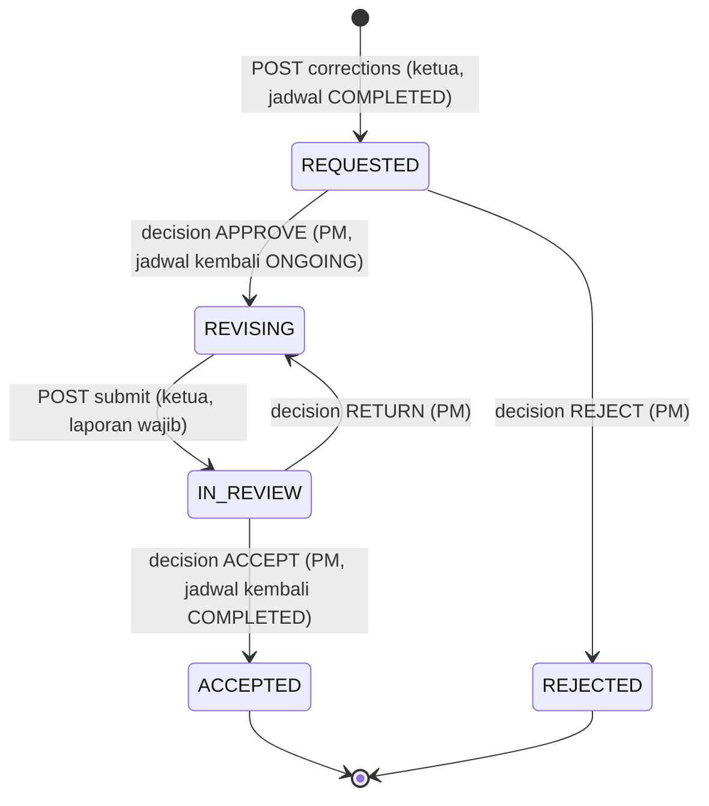

## 2.5 Status order klien: acc_status, order_status, dan BAST

Order disimpan di `work_completion`. Tiga dimensi berjalan terpisah:

1. **acc_status** (ACC klien): MENUNGGU_ACC, DITERIMA, DITOLAK_REWORK. Diisi di `api/app/modules/work_completion/repositories/work_completion_revision_repository.py:17-51` dan dibuat sebagai MENUNGGU_ACC (`work_completion_core_repository.py:408`).
2. **order_status**: nilai `PENDING`, `CANCELLED`, `ONGOING`, `URGENT`, `COMPLETED` (PATCH status, `work_completion_service.py:262`). ACC menulis `WAITING_ACC`, `ACCEPTED`, `REWORK` (`work_completion_revision_repository.py:25-30`). Constraint DB mengenal semua nilai ini (`api/alembic/versions/0043_work_plan_flow_revamp.py:49`). Dua kosakata bercampur (T11).
3. **BAST**: tanda tangan ketua dan PM (`leader_signed_at`, `pm_signed_at`, `signature_hash`).

### 2.5a ACC klien (acc_status)

| Transisi | Endpoint | Siapa | Prasyarat | Efek samping | Bukti |
|---|---|---|---|---|---|
| (awal) to MENUNGGU_ACC | POST /work-completions | SUPER_ADMIN, OM, PM (atas nama diri sendiri) | Peran dicek di service (`work_completion_service.py:183-189`); divisi order wajib (`:201`); proyek ONGOING bila dipakai (`:211-213`) | order_status awal ONGOING (`work_completion_core_repository.py:458`) | `work_completion_service.py:181-234` |
| MENUNGGU_ACC to DITERIMA | POST /work-completions/:id/acc-decision | PM, OM, SUPER_ADMIN (manage) | `_access` manage (`work_completion_service.py:406`). Tidak ada cek urutan. | order_status ACCEPTED, `acc_decided_at` diisi | `work_completion_revision_repository.py:17-51` |
| MENUNGGU_ACC to DITOLAK_REWORK | POST /work-completions/:id/acc-decision | Sama | Tidak ada cek urutan | order_status REWORK. Item utama (`is_main_deliverable`) dibuka ulang TODO, `source_type = REWORK`, progres nol (`work_completion_revision_repository.py:53-67`, `work_completion_service.py:407-409`) | `work_completion_revision_repository.py:53-67` |
| DITERIMA atau DITOLAK_REWORK to MENUNGGU_ACC | POST /work-completions/:id/acc-decision | Sama | Tidak ada cek urutan. `acc_decided_at` dikosongkan. | order_status WAITING_ACC | `work_completion_revision_repository.py:17-51` |

### 2.5b BAST (tanda tangan)

| Transisi | Endpoint | Siapa | Prasyarat | Efek samping | Bukti |
|---|---|---|---|---|---|
| BELUM_TTD to TTD_KETUA | POST /work-completions/:id/sign (peran TEAM_LEADER) | Ketua yang mengerjakan order (`on_team`) | Belum PM tanda tangan (409 ORDER_LOCKED). Ringkasan terisi (422). Foto hasil kerja berupa gambar (422). PNG valid (422). | Berkas PNG `signatures/work-completion/:id/leader.png` di MinIO (503 bila gagal). `leader_signed_at` diisi. Notifikasi ke PM divisi. | `work_completion_service.py:274-330`; `work_completion_sign_repository.py:16-50` |
| TTD_KETUA to TTD_KETUA (ulang) | POST sign (TEAM_LEADER) | Sama | Sebelum PM tanda tangan | Sidik direset (catatan di `work_completion_sign_repository.py:16`) | `work_completion_sign_repository.py:16` |
| TTD_KETUA to TERKUNCI | POST /work-completions/:id/sign (PM atau OM) | Manage (PM order, PM, OM divisi, SUPER_ADMIN) | `leader_signed_at` terisi (409 LEADER_SIGNATURE_REQUIRED, `:301-304`). `pm_signed_at` kosong (409). | `pm_signed_at`, `order_status = COMPLETED`, `signature_hash` = SHA-256 (`work_completion_service.py:332-335`; `work_completion_sign_repository.py:43-50`) | `work_completion_sign_repository.py:43-50` |
| TERKUNCI (efek) | Semua tulis order (PUT, PATCH status, BoM, revisi, sign) | | Ditolak 409 ORDER_LOCKED | | `work_completion_service.py:148-153` |
| Hapus order | DELETE /work-completions/:id | Manage | Ditolak 409 bila `leader_signed_at` terisi, kecuali SUPER_ADMIN | | `work_completion_service.py:237-242` |

Catatan: tidak ada guard `acc_status == DITERIMA` pada sign (T10).

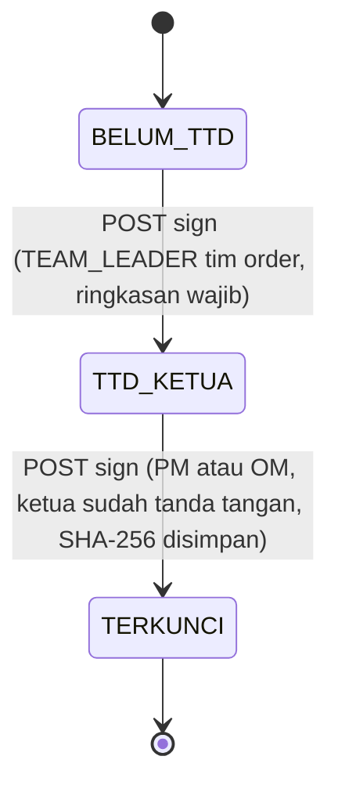

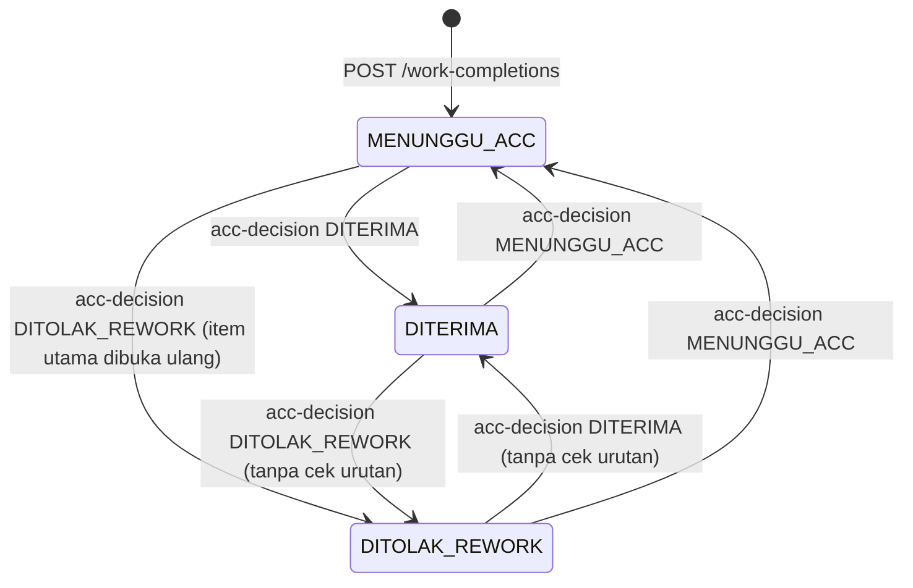

### 2.5c order_status (PATCH manual)

PATCH /work-completions/:id/status menerima `PENDING`, `CANCELLED`, `ONGOING`, `URGENT`, `COMPLETED` (`work_completion_service.py:262`). Ditolak 409 bila order sudah terkunci PM. Tidak ada cek BAST sebelum status COMPLETED (T10).

## 2.6 Status absensi (turunan `om_approval_status`)

Status tampilan diturunkan dari `om_approval_status` (`api/app/modules/attendance/repositories/attendance_session_repository.py:84-87`):

- AUTO_VALID: `AUTO_VALID`.
- APPROVED_BY_OM: `APPROVED`.
- REJECTED_BY_OM: `REJECTED`.
- PENDING_OM atau lainnya: `NEEDS_REVIEW`.

| Transisi | Endpoint | Siapa | Prasyarat | Efek samping | Bukti |
|---|---|---|---|---|---|
| (awal) to AUTO_VALID | POST /attendance/check-in | Pekerja | Dalam radius (`repository.py:365`, `is_within_radius`) | `om_approval_status = AUTO_VALID` | `attendance_session_repository.py:365` |
| (awal) to NEEDS_REVIEW | POST /attendance/check-in | Pekerja | Di luar radius dengan penjelasan (422 bila kosong, `attendance_session_service.py:387-393`); atau wajah layanan mati; atau offline | `PENDING_OM`, `_flag_for_review` memberi notifikasi (`attendance_session_service.py:258-268`) | `attendance_session_repository.py:365`; `attendance_session_service.py:241-256` |
| NEEDS_REVIEW to APPROVED | POST /attendance/:id/review (approve) | REVIEW_ATTENDANCE, dan `can_review` (SUPER_ADMIN, OM, PM, ADMIN_HR_GA; bukan diri sendiri) | Status menunggu (409); catatan wajib (422) | `APPROVED_BY_OM`, notifikasi `attendance_decided` | `attendance_session_service.py:675-700`; `attendance_route.py:130-142` |
| NEEDS_REVIEW to REJECTED | POST /attendance/:id/review (reject) | Sama | Sama | `REJECTED_BY_OM`. Peringatan T3 berlaku. | `attendance_session_service.py:675-700` |

Catatan: absensi yang ditolak dibatasi `MAX_ATTEMPTS_PER_DAY = 2` per hari (`attendance_session_service.py:73`, 409 ATTENDANCE_DAY_LOCKED di `:360`). Absen masuk kedua pada hari yang sama ditolak 409 ALREADY_CHECKED_IN (`:354`).

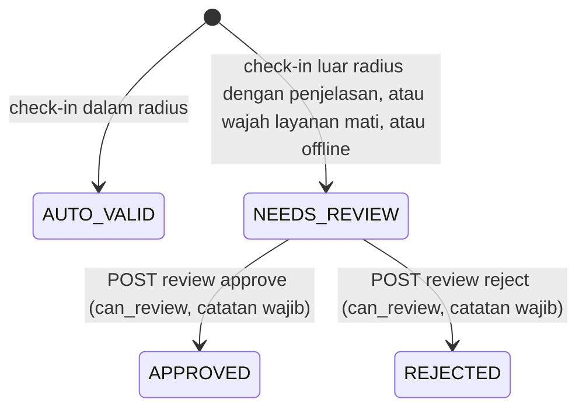

## 2.7 Sesi absen, perangkat offline, dan sesi login

### 2.7a Sesi absen harian

Sesi terbuka menghalangi absen masuk kedua di hari yang sama (409 OPEN_SESSION, `attendance_session_service.py:357`). Check-out hanya untuk sesi terbuka (409 NO_OPEN_SESSION, `:453`).

| Transisi | Endpoint | Siapa | Prasyarat | Efek samping | Bukti |
|---|---|---|---|---|---|
| (tidak ada) to SESI_TERBUKA | POST /attendance/check-in | Ketua, anggota (MOBILE). Pekerja kantor (WEB). | Lihat 2.6 dan `attendance_route.py:92-103` | Baris attendance dibuat | `attendance_session_service.py:270-424` |
| SESI_TERBUKA to SESI_TUTUP | POST /attendance/check-out | Pemilik sesi; kanal sesuai mode | Akurasi GPS maksimal 100 m, browser 300 m (`:75-77`) | `check_out_at` diisi | `attendance_session_service.py:426-541` |
| SESI_TERBUKA to SESI_TUTUP (otomatis) | POST /attendance/auto-checkout (cron) | RUN_SYSTEM_JOBS (ADMIN, SUPER_ADMIN) | Sesi masih terbuka | Check-out otomatis | `attendance_cron_route.py:48`, `:26` |

### 2.7b Perangkat offline

| Transisi | Endpoint | Siapa | Prasyarat | Efek samping | Bukti |
|---|---|---|---|---|---|
| (belum) to TERDAFTAR | POST /attendance/device-key | Pekerja login | Kunci publik ECDSA valid | Kunci tersimpan untuk perangkat | `attendance_offline_service.py:54-75`; `attendance_route.py:68` |
| TERDAFTAR, menerima absen | POST /attendance/offline | Pekerja lapangan | Tanda tangan valid (`OFFLINE_TAMPERED`); jam dapat dipastikan (`OFFLINE_TIME_UNKNOWN`); tidak lebih dari 7 hari (`OFFLINE_TOO_OLD`); idempoten per `client_op_id` | Absen tercatat, bila wajah tidak cocok ditandai | `attendance_offline_service.py:78-190`; `:146-220` |

Catatan: absen offline tidak ditolak karena wajah tidak cocok. Hasilnya ditandai untuk OM (`attendance_session_service.py:231-239`).

### 2.7c Sesi login (`user_sessions`)

| Transisi | Endpoint | Siapa | Prasyarat | Efek samping | Bukti |
|---|---|---|---|---|---|
| (login) to AKTIF | POST /auth/login | Pengguna | Kredensial valid | Sesi dan keluarga token baru | `auth_login_route.py` [VERIFIKASI detail] |
| AKTIF to DICABUT | POST /auth/sessions/:id/revoke atau POST /auth/sessions/revoke-others, atau logout | Pemilik sesi | | `is_revoked = TRUE` | `auth_session_route.py:35-46`; `auth_session_repository.py:205` |
| AKTIF to DICABUT (deteksi ulang) | POST /auth/refresh memakai token lama | Penyerang atau klien | Token sudah revoked atau dihapus | Seluruh `token_family_id` dicabut | `auth_session_repository.py:190-197` |
| AKTIF to KADALUARSA | (waktu lewat) | | `expires_at` lewat | Ditolak tanpa mencabut keluarga sesi | `auth_session_repository.py:185-188` |

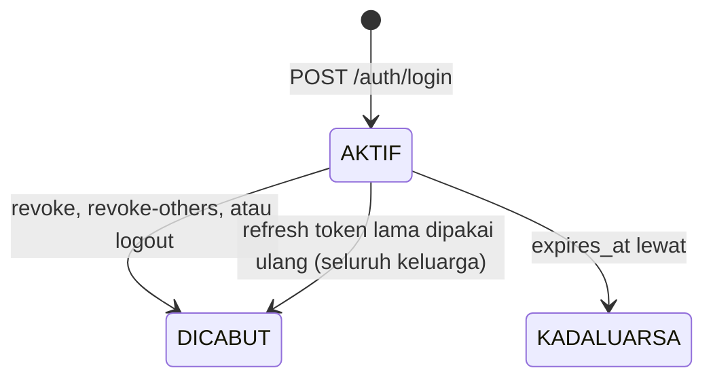

## 2.8 Status proyek (`projects.status`)

Status: DRAFT, ONGOING, COMPLETED, CANCELLED (`api/app/modules/projects/schemas/project_schema.py:11`).

- Proyek COMPLETED atau CANCELLED hanya boleh ubah status (409 PROJECT_CLOSED, `api/app/modules/projects/services/project_service.py:64-66`).
- Hapus proyek ditolak bila sudah dipakai jadwal atau order (409 PROJECT_IN_USE, `:81-82`).
- Jadwal harian dan order hanya boleh memakai proyek ONGOING (`daily_plan_service.py:128-129`; `work_completion_service.py:212-213`).
- Tidak ada cek urutan transisi status proyek pada kode service (sebatas status apa pun ke status apa pun) [VERIFIKASI].

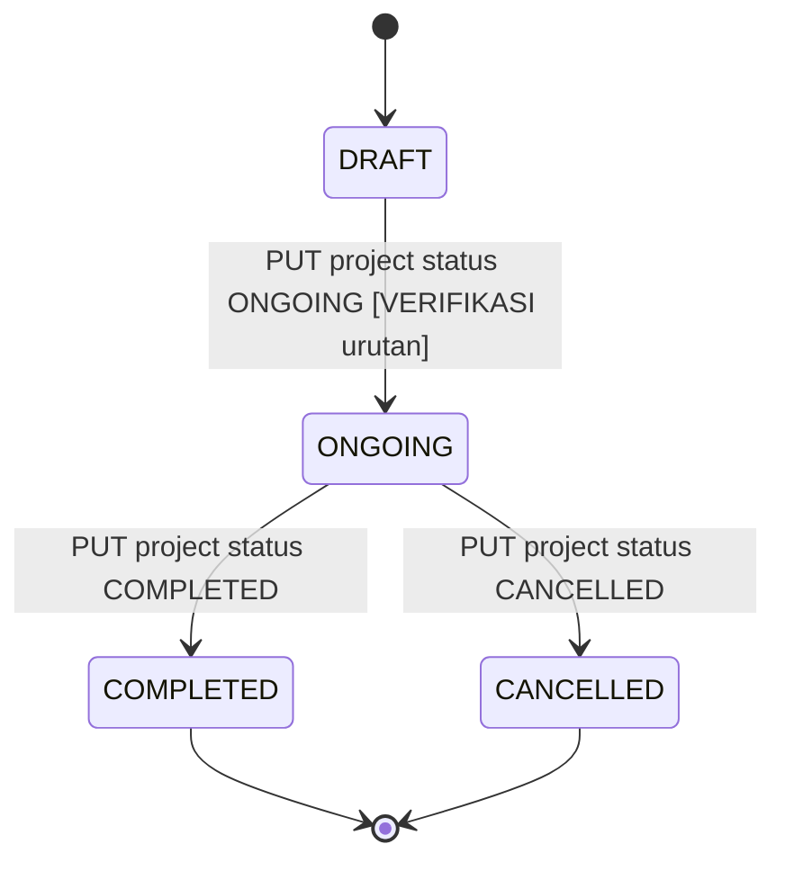
