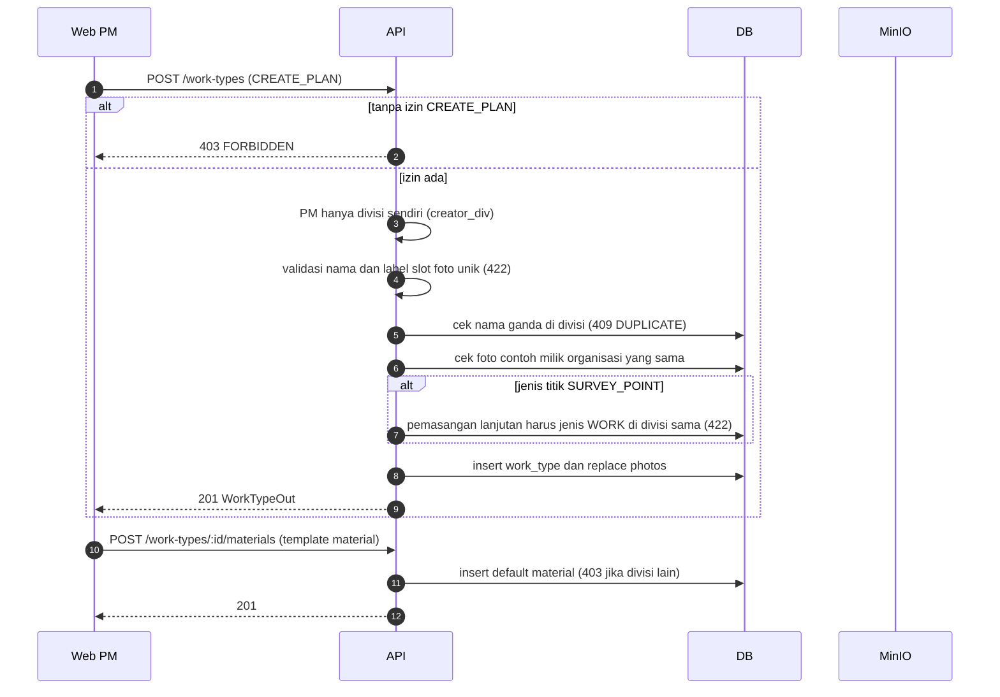
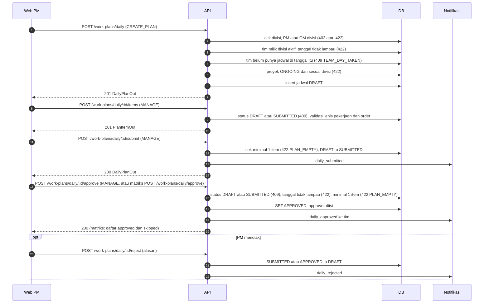
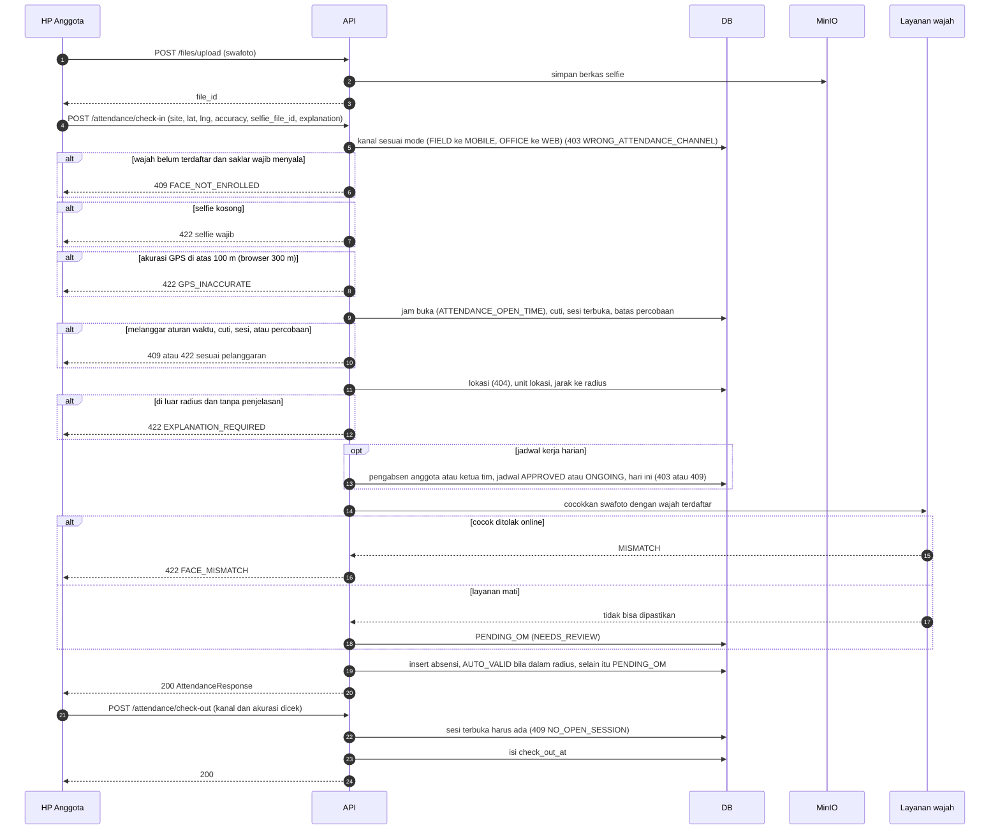
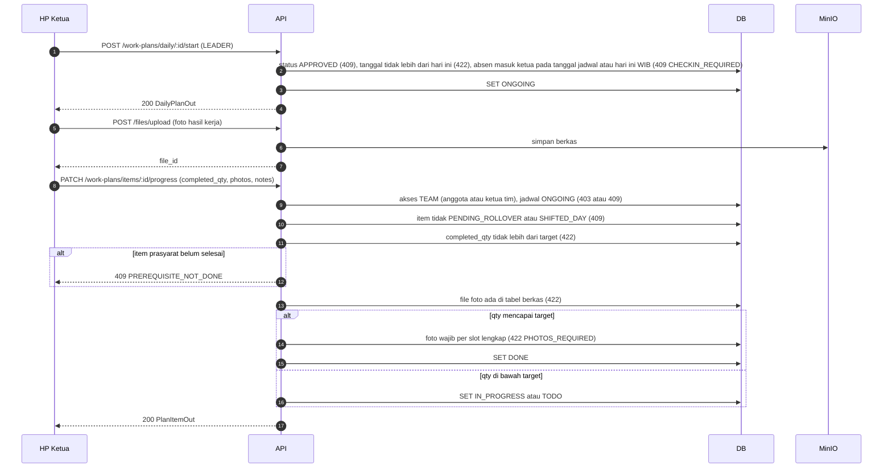
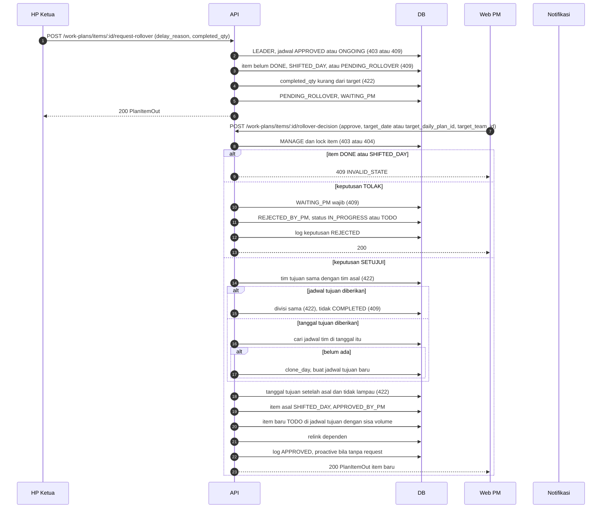
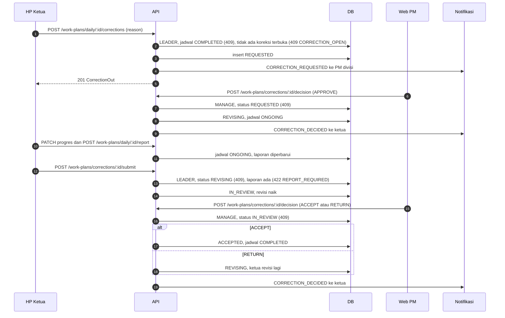
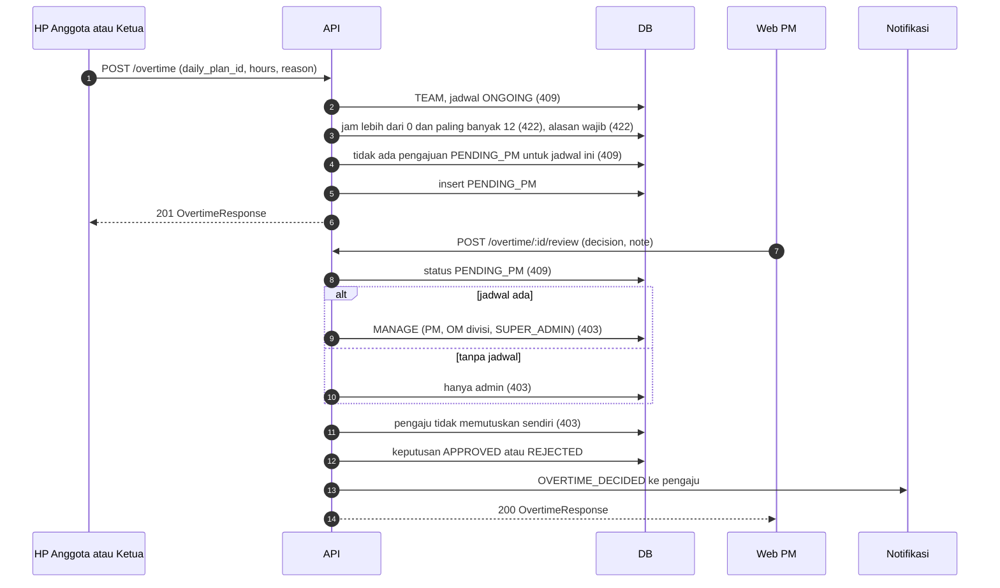
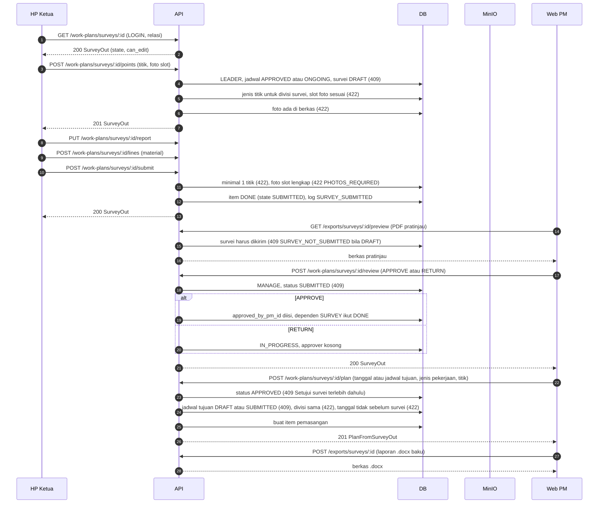
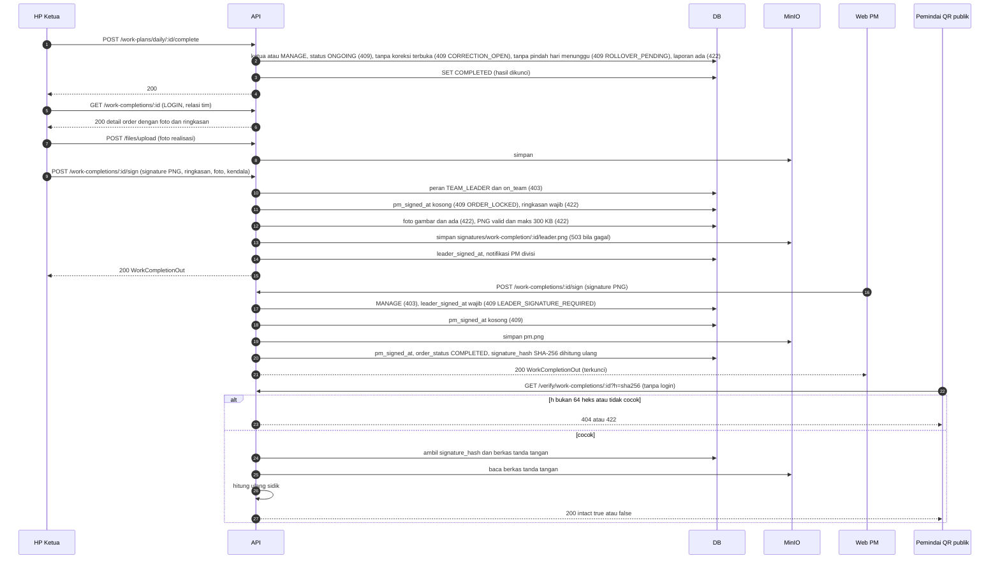
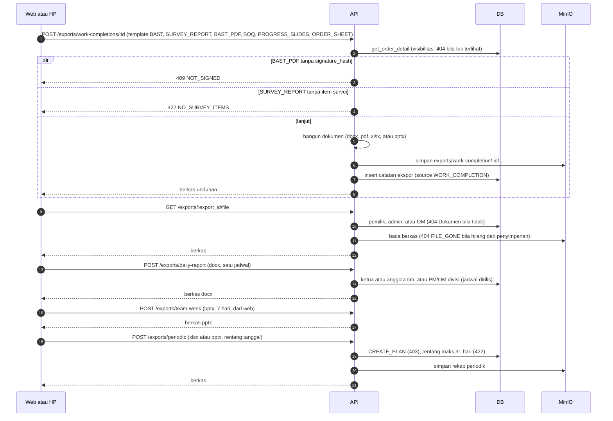

# 03. Sequence diagram

Dibuat dari kode per 2026-10-29. Pelaku: web (browser kantor), HP (aplikasi Flutter), API (FastAPI), DB (Postgres), MinIO (penyimpanan berkas). Setiap diagram diikuti tabel referensi berkas:baris.

Keterangan kode galat dalam diagram: 401 belum login, 403 izin atau relasi kurang, 404 tidak terlihat, 409 status tidak sesuai, 422 validasi.

## 3.1 Buat jenis pekerjaan (beserta template foto)

Referensi: `api/app/modules/work_types/routes/work_type_route.py:61-76`, `api/app/modules/work_types/services/work_type_service.py:38-60` (validasi), `:62-79` (create), `:104-114` (`_check_kind`), `:133-147` (material).

## 3.2 Buat dan setujui jadwal harian

Referensi: `api/app/modules/work_plans/routes/daily_plan_route.py:82-93,131-149`; `api/app/modules/work_plans/services/daily_plan_service.py:113-150` (create), `:215-246` (submit, approve, reject), `:231-240` (matriks).

## 3.3 Absen masuk dan absen pulang (HP)

Referensi: `api/app/modules/attendance/routes/attendance_route.py:92-115`; `api/app/modules/attendance/services/attendance_session_service.py:97-107` (kanal), `:205-217` (wajah), `:219-229` (jadwal harian), `:231-239` (verifikasi wajah), `:270-424` (check-in), `:426-541` (check-out); `api/app/modules/attendance/repositories/attendance_session_repository.py:365` (AUTO_VALID atau PENDING_OM).

Varian offline (`POST /attendance/offline`): data ditandatangani perangkat (ECDSA, kunci didaftarkan lewat `POST /attendance/device-key`). Server memverifikasi tanda tangan, jam jangkar, dan batas 7 hari (`api/app/modules/attendance/services/attendance_offline_service.py:78-190`).

## 3.4 Mulai hari kerja, isi progres item, dan unggah foto

Referensi: `api/app/modules/work_plans/routes/daily_plan_route.py:152-157`; `api/app/modules/work_plans/services/daily_plan_service.py:249-255`; `api/app/modules/work_plans/services/plan_item_service.py:164-192`; `api/app/modules/work_plans/repositories/plan_item_repository.py:197-225`. Foto wajib dicek hanya saat qty mencapai target (`plan_item_service.py:186-190`) [VERIFIKASI praktik UI].

## 3.5 Rollover (minta pindah hari, keputusan PM)

Referensi: `api/app/modules/work_plans/routes/plan_item_route.py:82-95`; `api/app/modules/work_plans/services/plan_item_service.py:194-275`; `api/app/modules/work_plans/repositories/plan_item_repository.py:233-268`.

## 3.6 Koreksi laporan harian

Referensi: `api/app/modules/work_plans/routes/daily_correction_route.py:33-64`; `api/app/modules/work_plans/services/daily_correction_service.py:37-115`.

## 3.7 Lembur

Referensi: `api/app/modules/overtime/routes/overtime_route.py:26-34,59-68`; `api/app/modules/overtime/services/overtime_service.py:50-93`. Rekap: `GET /recaps/overtime` (`overtime_service.py:111-116`).

## 3.8 Survei (isi, kirim, tinjau, buat rencana)

Referensi: `api/app/modules/work_plans/routes/survey_route.py:36-132`; `api/app/modules/work_plans/services/survey_service.py:76-99` (editable), `:208-270` (titik dan kirim), `:325-333` (tinjau), `:335-404` (rencana); `api/app/modules/exports/routes/export_route.py:47-56,85-93`.

## 3.9 Selesai, BAST tanda tangan, dan verifikasi publik

Referensi: `api/app/modules/work_completion/routes/work_completion_route.py:147-158` (sign), `:276-283` (verify); `api/app/modules/work_completion/services/work_completion_service.py:274-336` (sign), `:338-357` (verify); `api/app/modules/work_completion/repositories/work_completion_sign_repository.py:16-50`; `api/app/modules/work_plans/services/daily_plan_service.py:257-269`. Catatan: `sign_order` tidak memeriksa `acc_status` (T10).

## 3.10 Ekspor dokumen

Referensi: `api/app/modules/exports/routes/export_route.py:36-44,105-146`; `api/app/modules/exports/services/export_service.py:66-72` (templat), `:225-238` (ekspor order), `:246-263` (periodik), `:268-290` (unduh). Survei: `:115-135`.

## 3.11 Referensi cepat (sumber endpoint di web)

| Aksi web | Service web (berkas) | Endpoint |
|---|---|---|
| Submit, approve, start, complete jadwal | `web/src/services/dailyPlanService.ts:90-107` | `/work-plans/daily/:id/:action` |
| Item progres, rollover | `web/src/services/planItemService.ts:168-180` | `/work-plans/items/:id/...` |
| Koreksi | `web/src/services/dailyPlanService.ts:182-187` | `/work-plans/corrections/...` |
| Survei | `web/src/services/surveyService.ts:24-148` | `/work-plans/surveys/...` |
| Order klien dan BAST | `web/src/services/workCompletionService.ts:88-285` | `/work-completions/...` |
| Lembur | `web/src/services/overtimeService.ts:9-19` | `/overtime`, `/overtime/:id/review` |
| Verifikasi publik | `web/src/services/exportService.ts:79` | `/verify/work-completions/:id?h=` |
