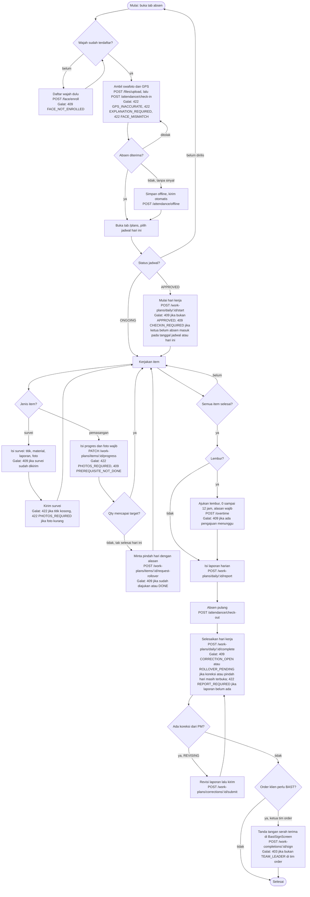
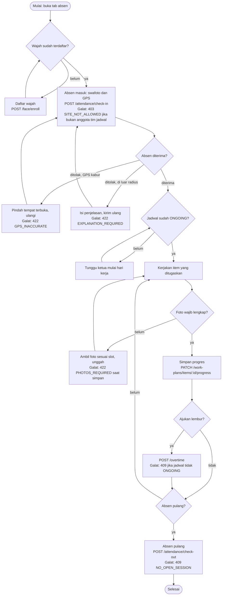
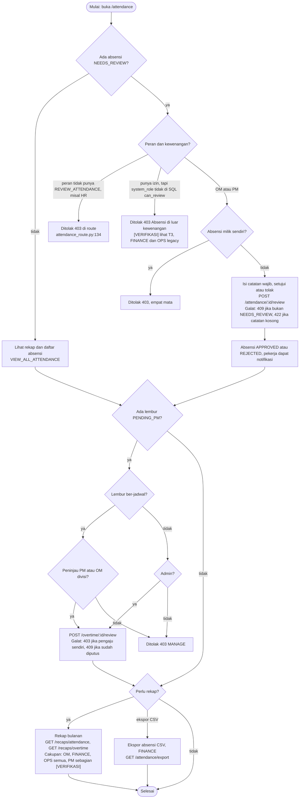

# 04. Activity per peran

Dibuat dari kode per 2026-10-29. Satu diagram per peran pelaku. Setiap keputusan dan jalur galat merujuk ke kode galat di service. Layar web dari `web/src/app/routes.tsx`, layar HP dari `mobile/lib/shared/router.dart`.

Istilah: "PM" di diagram mencakup PM divisi dan OM divisi, karena keduanya memakai relasi `pm_id` atau `om_id` (`api/app/shared/access/access_service.py:94-100`).

## 4.1 PM (web kantor)

Layar utama: `/work-plans` (jadwal harian), `/surveys` dan `/surveys/:id`, `/work-completions`, `/projects`, `/clients`, `/work-types`, `/attendance`, `/overtime-recap`, `/teams`, `/sites`.

```mermaid
flowchart TD
    S(["Mulai: PM buka /work-plans"]) --> P1{"Ada tim yang perlu jadwal?"}
    P1 -->|"tidak"| P9(["Selesai"])
    P1 -->|"ya"| P2["Buat jadwal DRAFT per tim per tanggal<br/>POST /work-plans/daily<br/>Galat: 422 jika tim tidak di divisi, tanggal lampau, atau proyek tidak ONGOING<br/>Galat: 409 TEAM_DAY_TAKEN jika tim sudah punya jadwal"]
    P2 --> P3["Tambah item per titik<br/>POST /work-plans/daily/:id/items<br/>Galat: 409 jika jadwal bukan DRAFT atau SUBMITTED"]
    P3 --> P4["Submit ke SUBMITTED<br/>POST submit<br/>Galat: 422 PLAN_EMPTY jika belum ada item"]
    P4 --> P5{"Setujui atau tolak"}
    P5 -->|"tolak dengan alasan"| P6["POST reject, kembali DRAFT<br/>Galat: 409 jika status bukan SUBMITTED atau APPROVED"]
    P6 --> P2
    P5 -->|"setujui satu-satu"| P7["POST approve<br/>Galat: 422 jika tanggal lampau<br/>Galat: 403 jika bukan PM divisi"]
    P5 -->|"setujui matriks"| P8["POST /work-plans/daily/approve<br/>Jadwal gagal dilewati (termasuk tanpa item, PLAN_EMPTY), dilaporkan di skipped"]
    P7 --> P10["Jadwal APPROVED, tim dapat notifikasi"]
    P8 --> P10
    P10 --> P11{"Ada pekerjaan pindah hari?"}
    P11 -->|"ya"| P12["Buka panel item<br/>Setujui atau tolak pindah hari<br/>POST /work-plans/items/:id/rollover-decision<br/>Galat: 409 jika item sudah DONE atau SHIFTED_DAY"]
    P11 -->|"tidak"| P13{"Ada koreksi laporan terbuka?"}
    P12 --> P13
    P13 -->|"ya"| P14["Putuskan koreksi di CorrectionsPanel<br/>APPROVE, REJECT, ACCEPT, atau RETURN<br/>Galat: 409 jika status tidak sesuai"]
    P13 -->|"tidak"| P15{"Ada lembur menunggu?"}
    P14 --> P15
    P15 -->|"ya"| P16["Putuskan lembur di /overtime-recap<br/>Galat: 403 jika mengajukan sendiri"]
    P15 -->|"tidak"| P17{"Ada absensi NEEDS_REVIEW?"}
    P16 --> P17
    P17 -->|"ya"| P18["Tinjau absensi di /attendance<br/>Catatan wajib<br/>Galat: 403 jika absen sendiri atau di luar kewenangan"]
    P17 -->|"tidak"| P19{"Survei dari ketua sudah dikirim?"}
    P18 --> P19
    P19 -->|"ya"| P20["Tinjau survei di /surveys/:id<br/>APPROVE atau RETURN<br/>Galat: 409 jika bukan SUBMITTED"]
    P19 -->|"tidak"| P22
    P20 --> P21{"Survei APPROVED?"}
    P21 -->|"ya"| P21a["Buat rencana pemasangan<br/>POST /work-plans/surveys/:id/plan<br/>Galat: 409 jika jadwal tujuan sudah APPROVED"]
    P21 -->|"tidak, RETURN"| P20
    P21a --> P22
    P22{"Order klien selesai dikerjakan?"}
    P22 -->|"belum"| P9
    P22 -->|"ya"| P23["ACC klien di /work-completions<br/>POST acc-decision<br/>DITOLAK_REWORK membuka ulang item utama"]
    P23 --> P24{"ACC DITERIMA?"}
    P24 -->|"tidak, REWORK"| P2
    P24 -->|"ya"| P25{"Ketua sudah tanda tangan BAST?"}
    P25 -->|"belum"| P26["Tunggu ketua tanda tangan<br/>Galat: 409 LEADER_SIGNATURE_REQUIRED jika PM mendahului"]
    P26 --> P25
    P25 -->|"ya"| P27["Tanda tangan BAST sebagai PM<br/>POST /work-completions/:id/sign<br/>Order terkunci, signature_hash tersimpan"]
    P27 --> P28["Ekspor dokumen: BAST docx, BoQ xlsx, slide pptx<br/>BAST PDF ber-QR hanya setelah tanda tangan PM"]
    P28 --> P9
```

Catatan: akun PM hanya bisa membuat order atas nama dirinya sendiri (`pm_id` harus sama dengan karyawan login). Lihat `work_completion_service.py:183-189`.

## 4.2 Ketua tim (HP lapangan)

Layar utama: tab `/` (absen, `AttendanceScreen`), tab `/plans` (jadwal, `DailyPlansScreen` lalu `DailyPlanScreen`), `SurveyScreen`, `ItemProgressScreen`, `BastSignScreen`.

Catatan: "ketua" dalam diagram ini berarti relasi `team.leader_employee_id` pada jadwal (`access_service.py:44-87`). Untuk BAST, kode juga mewajibkan peran `TEAM_LEADER` (`work_completion_service.py:288-293`). Lihat T12.

## 4.3 Anggota tim (HP lapangan)

Layar: sama dengan ketua, tanpa tombol mulai, selesai, koreksi, dan BAST.

Catatan: anggota tidak punya izin untuk tombol mulai dan selesai (`daily_plan_route.py:152-163` memakai relasi ketua di service). Jika anggota mengirim progres saat jadwal bukan ONGOING, server mengembalikan 409 (`plan_item_service.py:166`).

## 4.4 Reviewer absensi dan lembur (OPS, FINANCE, OM)

Layar web: `/attendance` (tinjau absensi, `AttendanceReviewDialog.tsx`), `/overtime-recap` (rekap dan keputusan lembur), `/attendance-recap` (rekap bulanan). Peran: OPS dan FINANCE memiliki REVIEW_ATTENDANCE dan REVIEW_OVERTIME (`api/app/core/permissions.py:109-122`), OM memiliki keduanya (`permissions.py:132-136`).

Catatan: pemeriksaan galat untuk tinjau absensi ada di `api/app/modules/attendance/services/attendance_session_service.py:675-700`. Rekap lembur untuk PM dibatasi oleh `overtime_service.py:111-116` [VERIFIKASI cakupan divisi].
